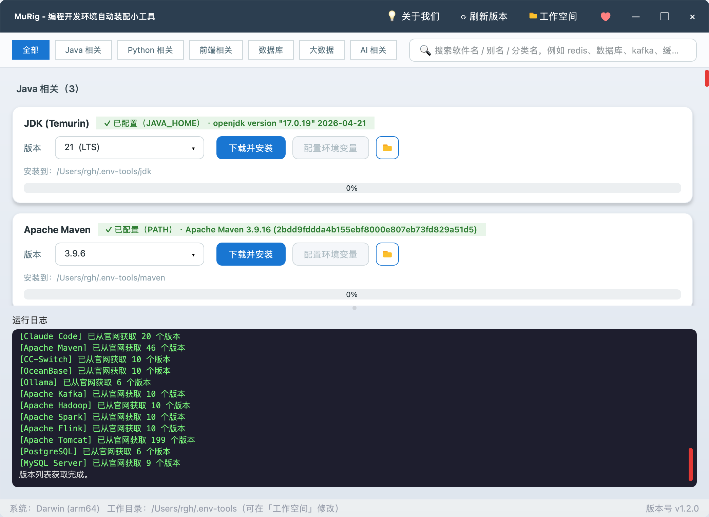
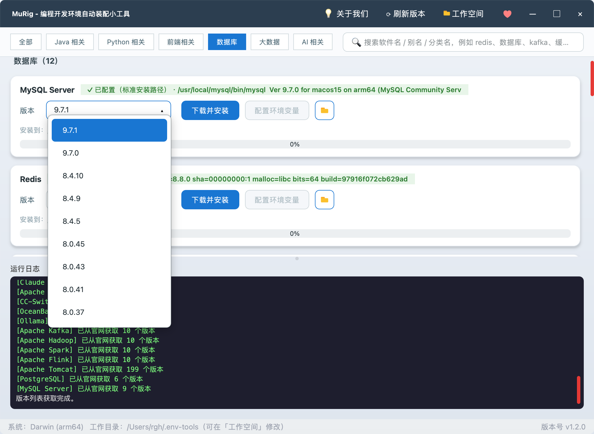
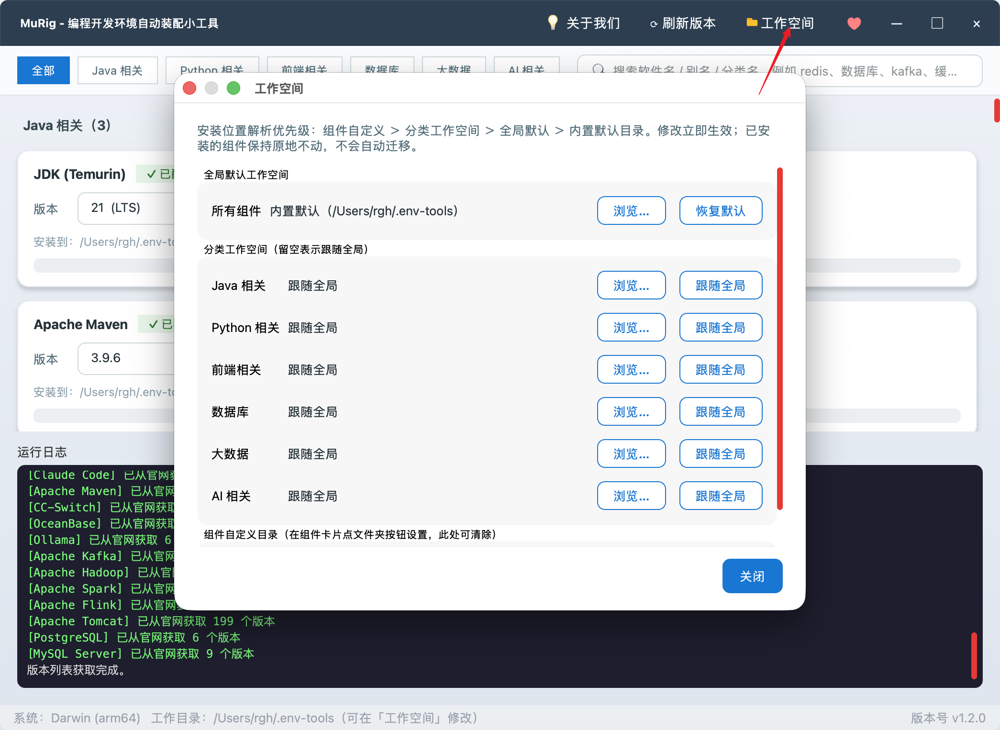

# MuRig · 编程开发环境自动装配小工具

<p align="center">
  
</p>

<p align="center">
  一款基于 <b>Python + PySide6</b> 的跨平台桌面 GUI 工具<br/>
  一键完成 <b>下载 → 解压 → 环境变量配置</b> 全流程，让开发环境搭建不再是重复劳动
</p>

<p align="center">
  
  
  
  
  
</p>

---

## 🧬 关于本项目（二次开发）

> **本项目基于开源项目 [MuRig](https://github.com/vfaner/murig) 的 v1.2.0 版本制作演变而来。**

原项目由 [沐编程](https://nav.qqmu.com) 开源（MIT 协议），已实现"下载 → 解压 → 环境变量配置"的完整链路。本仓库在其 v1.2.0 基础上进行二次开发：沿用原有核心能力，**新增并修复了部分功能，让日常使用更顺手**，同时保留原作者的署名与授权。

应用内 **「关于我们」** 弹窗同样标注了这段溯源信息（顶部展示应用图标与项目溯源说明，原作者的"关于我们"内容以弱化卡片形式保留）。

### ✨ 相对 MuRig v1.2.0 的改动

| 类别 | 改动 |
|------|------|
| 🆕 新增 | **一键打开工作目录**：标题栏「打开目录」按钮，用系统文件管理器（资源管理器 / Finder / 桌面文件管理器）打开当前工作空间；设置弹窗里全局与每个分类也各有「打开」 |
| 🆕 新增 | **安装包清理**：组件解压安装完成后自动清理下载的压缩包；设置弹窗「安装包清理」还可一键清掉所有工作空间 `downloads` 目录里的残留包 |
| 🆕 新增 | **旧版本冲突提示**：写入环境变量后若系统 PATH 里仍存在同名旧版本，弹窗列出旧版本目录，并可**以管理员权限**一键打开系统环境变量窗口（UAC 提权） |
| 🔧 优化 | **「工作空间」弹窗升级为「设置」**：汇聚安装目录、下载通道与测速、安装选项、安装包清理；顶栏按钮同步改名并换成齿轮图标 |
| 🔧 优化 | **安装选项改为滑动开关**：原复选框太小太淡、看不出可交互，改为自绘开关（选中紫色填充 + 悬停反馈） |
| 🔧 优化 | **界面图标统一**：关于 / 刷新 / 设置 / 目录按钮改用统一的 SVG 图标包（`assets/icons`），按调用处注入填充色 |
| 🔧 优化 | **关于我们**：新增应用图标与项目溯源；顶栏「支持作者」弹窗合并进「关于我们」（本版本已移除该打赏区块与二维码资源，相关内容回归原项目） |
| 🐛 修复 | 环境变量窗口此前以普通权限打开，系统变量只读且无提权提示；改为 `ShellExecute(runas)` 提权启动 |

---

## 📥 下载即用（推荐）

> **不需要 Python 环境，不需要克隆源码，双击即可运行。** 到 **[原项目 Releases 页面](https://github.com/vfaner/murig/releases/latest)** 下载对应系统的版本：

| 系统 | 下载文件 | 说明 |
|------|----------|------|
| 🪟 **Windows** | [`murig.exe`](https://github.com/vfaner/murig/releases/latest/download/murig.exe) | 双击运行，无需安装 |
| 🍎 **macOS (Apple Silicon)** | [`murig-macos-arm64.zip`](https://github.com/vfaner/murig/releases/latest/download/murig-macos-arm64.zip) | 解压后双击 `murig.app` |
| 🍎 **macOS (Intel 芯片)** | [`murig-macos-x64.zip`](https://github.com/vfaner/murig/releases/latest/download/murig-macos-x64.zip) | 解压后双击 `murig.app` |
| 🐧 **Linux (x64)** | [`murig-linux-x64`](https://github.com/vfaner/murig/releases/latest/download/murig-linux-x64) | `chmod +x` 后直接运行 |

> 上表为原项目的发布产物；使用本二次开发版本请直接克隆本仓库运行源码，或用 PyInstaller 自行打包（见「自定义与打包」章节）。

首次启动提示：

- **macOS**：未做代码签名，若提示"无法验证开发者"，到「系统设置 → 隐私与安全性」点击 **"仍要打开"**，或执行 `xattr -cr murig.app`
- **Windows**：SmartScreen 弹"未识别应用"时，点击 **"更多信息 → 仍要运行"**

---

## ✨ 功能特性

- 🖥️ **跨平台**：Windows / macOS / Linux，自动识别 x64 / arm64 并挑选正确的官方分发包
- 📦 **一键装配**：内置 29 个组件（语言运行时、构建工具、关系型/信创数据库、大数据全家桶、AI CLI），下载 → 解压（编译）→ 环境变量配置全流程自动化
- 🗂️ **分类与搜索**：六大分类胶囊一键筛选；搜索框支持软件名 / 别名（`es`、`缓存`）/ 分类名（`数据库`）模糊匹配
- 🌐 **动态版本**：后台向各官方 API / 归档拉取最新版本列表，下拉框可键入过滤；抓取失败自动回退内置清单，离线可用
- 🔍 **智能检测**：依次检查 `XXX_HOME` → `PATH` → 常见安装路径，已配置的组件显示 ✓ 且不会重复写入
- 🛠️ **环境变量写入**：Windows 走 `winreg` 直写注册表（规避 `setx` 1024 字符限制）；macOS/Linux 向 shell 配置写入带 marker 的幂等块
- ⚙️ **设置中心**：安装目录（全局 / 分类 / 单组件三级）+ 下载通道与测速 + 安装选项 + 安装包清理，见下方「设置」章节
- 📂 **打开目录 / 自动清理**：随时打开工作空间目录；组件解压安装后自动清理下载的安装包
- 🎨 **现代化 UI**：无边框窗口、圆角卡片、渐变进度条、四色分级日志
- 🧠 **偏好记忆**：记住每个组件上次选择的版本，下次启动自动恢复

---

## 🗂️ 项目结构

> 界面样式集中在 `murig/ui/styles/theme.qss` 全局主题中维护：控件只负责设置
> `objectName` / 属性，外观（配色、圆角、状态）全部由主题表描述，改主题即可换肤。

```
murig/
├── core/      平台能力层：常量 / 环境变量写入 / 归档解包 / 工作空间 / 后台线程
├── catalog/   组件清单、官方分发包 URL 构造、最新版本抓取
├── ui/        界面层：theme.qss 全局主题、通用控件、对话框、主窗口
│   └── icons.py   渲染 assets/icons/*.svg 并注入填充色（窗口控制按钮仍自绘）
└── app.py     应用入口（python main.py 启动）

tools/
├── smoke.py        无头冒烟测试（offscreen 构造主窗口与全部对话框）
├── check_names.py  静态检查模块缺失的符号绑定
├── screenshot.py   无头截图，便于人工核对视觉效果
└── prune_imports.py 清理未使用的 import
```

---

## 📦 支持的组件

> 表中为离线默认版本；启动后后台会自动向官方源抓取最新版本覆盖。大数据组件均依赖 JDK，请先安装 JDK。

### ☕ Java 相关

| 组件 | 环境变量 | 默认版本 |
|------|----------|----------|
| JDK (Temurin) | `JAVA_HOME` | 21 / 17 / 11 / 8 |
| Apache Maven | `MAVEN_HOME` | 3.9.x / 3.8.x |
| Apache Tomcat | `CATALINA_HOME` | 10.1 / 9.0 / 8.5 |

### 🐍 Python 相关

| 组件 | 环境变量 | 默认版本 | 说明 |
|------|----------|----------|------|
| Python | —（走 PATH） | 3.12 / 3.11 / 3.10 / 3.9 | |
| Miniconda | `CONDA_HOME` | py312 / py311 / py310 | 静默安装器模式 |

### 🎨 前端相关

| 组件 | 环境变量 | 默认版本 | 说明 |
|------|----------|----------|------|
| Node.js | `NODE_HOME` | 20 LTS / 18 LTS / 16 | 安装 Claude Code 的前置条件 |
| Git | — | MinGit (Windows) / 系统自带 | |

### 🗄️ 数据库

| 组件 | 环境变量 | 默认版本 | 说明 |
|------|----------|----------|------|
| MySQL Server | `MYSQL_HOME` | 9.7 / 8.4 LTS / 8.0 | 需自行 `mysqld --initialize`；可识别标准安装路径 |
| MariaDB | `MARIADB_HOME` | 12.3 / 11.4 LTS / 10.11 LTS | 需自行初始化数据目录 |
| SQL Server 2025 Express | — | 2025 Express | 仅 Windows，官方在线引导程序向导安装 |
| PostgreSQL | `PG_HOME` | 18 / 17 / 16 | Linux 源码自动编译；需自行 `initdb` |
| Redis | `REDIS_HOME` | 8.4 / 7.4 / 7.2 | macOS/Linux 源码自动 `make` |
| Elasticsearch | `ES_HOME` | 8.15 / 7.17 | 别名 `es` |
| openGauss | `OPENGAUSS_HOME` | 7.0 / 6.0 | 仅 Linux |
| 达梦 DM8 | — | 滚动最新 | zip 套 ISO，自动解出并提示挂载安装 |
| OceanBase | `OB_HOME` | 4.4 / 4.3 | 仅 Linux，纯 Python 解包 RPM |
| TiDB | `TIDB_HOME` | 8.5 / 8.1 / 7.5 | 仅 Linux |
| KingbaseES | `KINGBASE_HOME` | V9R3C11 / V8R6C8 | 仅 Linux，便携 server 包自带 license |
| YashanDB | `YASHANDB_HOME` | 23.4.1 | 仅 Linux，`yasboot` 初始化 |

### 📊 大数据

| 组件 | 环境变量 | 默认版本 |
|------|----------|----------|
| Apache Hadoop | `HADOOP_HOME` | 3.5 / 3.4 / 3.3 |
| Apache ZooKeeper | `ZOOKEEPER_HOME` | 3.9 / 3.8 |
| Apache Hive | `HIVE_HOME` | 4.2 / 4.0 / 3.1 |
| Apache HBase | `HBASE_HOME` | 3.0 / 2.6 |
| Apache Spark | `SPARK_HOME` | 4.2 / 4.0 / 3.5 |
| Apache Flink | `FLINK_HOME` | 2.3 / 1.20 / 1.18 |
| Apache Kafka | `KAFKA_HOME` | 4.3 / 3.9 / 3.8 |

### 🤖 AI 相关

| 组件 | 环境变量 | 默认版本 | 说明 |
|------|----------|----------|------|
| Ollama | —（走 PATH） | 0.12 / 0.3 | 本地大模型运行工具 |
| Claude Code | `CLAUDE_CODE_HOME` | 跟随 npm 最新 | npm 便携安装（需先装 Node.js） |
| CC-Switch | — | 4.0.x | Claude 供应商切换；Win 便携版 / .app / AppImage |

> ℹ️ 官网无免登录直链、暂未收录的数据库：IBM DB2、瀚高 HighGo、海量 Vastbase、南大通用 GBase、神通 Oscar，需要时请自行到官网申请。

---

## 📸 截图预览

<p align="center">
  <br/>
  <sub>版本下拉框：版本列表实时抓自官方源，可键入关键字过滤</sub>
</p>

<p align="center">
  <br/>
  <sub>设置弹窗：安装目录 / 下载通道 / 安装选项 / 安装包清理</sub>
</p>

<p align="center">
  <br/>
  <sub>关于我们：项目溯源（基于 MuRig v1.2.0）与原作者联系方式</sub>
</p>

---

## 🚀 快速开始（源码运行）

```bash
git clone <本仓库地址>
cd murig
pip install -r requirements.txt   # PySide6 + requests
python main.py
```

- 需要 Python 3.9+；首次启动自动创建工作目录（默认 `~/.env-tools/`，可在「设置」修改）
- macOS/Linux 装 Redis、Linux 装 PostgreSQL 需要 `make` 与 C 编译器；装 Claude Code 需先装 Node.js

工作目录布局：

```
~/.env-tools/              # 可在「设置」改到任意盘
├── jdk/
│   ├── downloads/         # 原始压缩包（解压安装后自动清理）
│   └── jdk-17/            # 解压后的组件
├── maven/
└── ...
```

---

## 📝 使用说明

1. **筛选（可选）**：点击分类胶囊，或在搜索框输入软件名 / 别名 / 分类名
2. **选择版本**：下拉框点选，或键入关键字（`21`、`3.12`、`LTS`）实时过滤
3. **下载并安装**：流式下载（可取消）→ 解压（源码包自动编译）→ 写入 `XXX_HOME` 并把 `bin` 追加到 `PATH` → 自动清理下载的安装包
4. **配置环境变量**：本地已下载的组件只执行环境变量配置
5. **查看日志**：底部日志区四色分级显示每一步执行情况

环境变量生效：Windows 新开终端即可；macOS/Linux 执行 `source ~/.zshrc`（或重开终端）。验证：`java -version`、`mvn -v`、`python --version`、`node -v`、`mysql --version`。

> ⚠️ Windows 若系统 PATH 中已装过同名旧版本，新开终端可能仍优先命中旧版（系统变量排在用户变量之前）。此时安装结束会弹窗提示旧版本所在目录，可点击「以管理员打开环境变量设置」移除旧条目。

---

## ⚙️ 设置（安装目录 / 下载通道 / 安装选项）

点击标题栏 **「设置」** 按钮打开设置弹窗。

**安装目录**解析优先级：

1. **组件自定义**：组件卡片上的文件夹图标按钮单独指定（右键该按钮可清除）；
2. **分类工作空间**：为六大分类分别指定目录；
3. **全局默认**：一键修改所有组件的安装位置；
4. 均未设置时回退内置默认 `~/.env-tools/`。

每行右侧都有 **「打开」** 按钮，直接在该目录里查看实际落盘位置；标题栏「打开目录」则打开当前全局工作空间。

**下载通道 / 安装选项 / 清理**：

- **下载通道**：内置通道与自定义前缀切换，可「测速」挑选最快的镜像，支持分段并发下载；
- **安装选项**：「安装完成后自动配置环境变量」滑动开关，关闭后只下载解压，需要时再在卡片上点「配置环境变量」；
- **安装包清理**：一键删除所有工作空间 `downloads` 目录里的压缩包（已安装组件不受影响）。

说明：

- 设置保存在 `~/.murig/config.json`，旧版 `~/.env-tools/config.json` 首次启动自动迁移；
- **已安装的组件原地不动**，环境变量仍指向旧路径，检测与使用不受影响；
- 下载缓存跟随当前工作空间，更换后未下载的组件需重新下载；
- 每张卡片的「安装到：…」实时显示该组件实际会安装到的目录。

---

## 🛠️ 自定义与打包

- **新增组件 / 版本**：编辑 `murig/catalog/registry.py` 的组件清单与 `murig/catalog/urls.py` 的 URL 构造；版本列表只是离线默认，启动后会被官方源抓取结果覆盖
- **更换镜像**：设置弹窗里直接选通道或填自定义前缀（华为云 `repo.huaweicloud.com`、清华 TUNA `mirrors.tuna.tsinghua.edu.cn`、阿里云 `mirrors.aliyun.com`）
- **更换图标**：替换 `assets/icons/*.svg`（关于 / 刷新 / 设置 / 文件夹），`murig/ui/icons.py` 会自动注入填充色
- **本地打包**：`pip install pyinstaller && pyinstaller murig.spec --noconfirm --clean`
- **自动发布**：推 tag（如 `git tag v1.2.0 && git push origin v1.2.0`），GitHub Actions 在 Windows / macOS (arm64 + x64) / Linux 上打包并自动创建 Release

---

## ❓ 常见问题（FAQ）

**版本抓取失败 / 下载卡住？** 抓取失败自动回退内置版本列表，功能不受影响；下载卡住点「取消」重试，或到设置里换通道 / 测速。

**环境变量写入失败 / 会覆盖旧值吗？** Windows 默认写用户级变量，通常无需管理员权限，失败时以管理员身份重跑。重复安装会用最新路径覆盖 `XXX_HOME`，`PATH` 只追加不重复。

**新装了版本但终端里还是旧的？** 多为系统 PATH 里残留旧版本。安装结束时的提示弹窗会列出旧目录，点「以管理员打开环境变量设置」移除即可。

**下载的安装包去哪了？** 组件解压安装完成后会自动清理；未自动清理的（如仅下载模式）可在设置弹窗「安装包清理」一键删除。

**MySQL 解压后能直接用吗？** 不能，还需自行 `mysqld --initialize`；本工具只负责下载 + 解压 + 环境变量。

**支持哪些归档格式？** `.zip`、`.tar.gz`、`.tar.xz`（MySQL Linux）、魔术字节识别的 `.tar`（KingbaseES 实为 gzip）、RPM（OceanBase，纯 Python 解包）、AppImage（需系统支持 FUSE）。

**安装 Claude Code 提示找不到 npm？** 先到「前端相关」分类安装 Node.js，再回到 Claude Code 卡片点击安装。

**信创数据库支持到什么程度？** openGauss / OceanBase / TiDB / KingbaseES / YashanDB 仅 Linux，自动下载并解包到工作目录；建用户、建数据目录等实例初始化按日志提示参照官方文档完成。

---

## 📁 目录结构

```
murig/
├── main.py                             # 程序入口
├── requirements.txt                    # 依赖清单
├── murig.spec                          # PyInstaller 打包配置
├── README.md / README_EN.md            # 中文 / 英文说明
├── LICENSE                             # MIT 许可证
├── .github/workflows/
│   └── build-and-release.yml           # 四产物自动构建 + 发布
└── assets/                             # 截图与界面图标
    ├── icons/                          # 界面 SVG 图标（info-circle / reload / setting / folder）
    ├── icon.ico                        # 应用图标（窗口 / 任务栏 / exe）
    ├── murig.png                       # 主界面截图
    ├── murig_db_version.png            # 版本下拉框截图
    ├── murig_work.png                  # 设置弹窗截图
    └── murig_about.png                 # 关于我们截图
```

---

## 📄 许可证与署名

- 本仓库为 **二次开发版本**，基于 [MuRig v1.2.0](https://github.com/vfaner/murig) 制作演变而来；
- 原项目版权所有 © 2026 [**沐编程**](https://nav.qqmu.com)，以 **MIT License** 开源，本仓库沿用该协议并保留原作者署名；
- 完整条款见 [LICENSE](LICENSE)。

欢迎 ⭐ Star、🐛 提 Issue、🔀 提 PR。

---

<p align="center">
  Original by <b><a href="https://nav.qqmu.com">沐编程</a></b> · Made with ❤️<br/>
  <sub>本仓库基于 MuRig v1.2.0 二次开发 —— 如果觉得有用，别忘了给原项目也点个 ⭐ Star！</sub>
</p>
